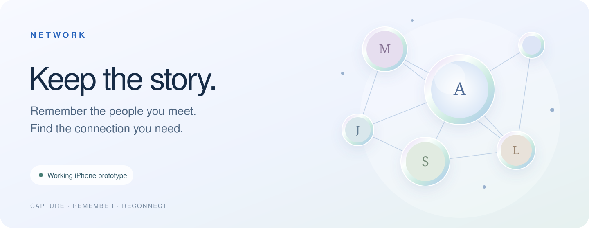
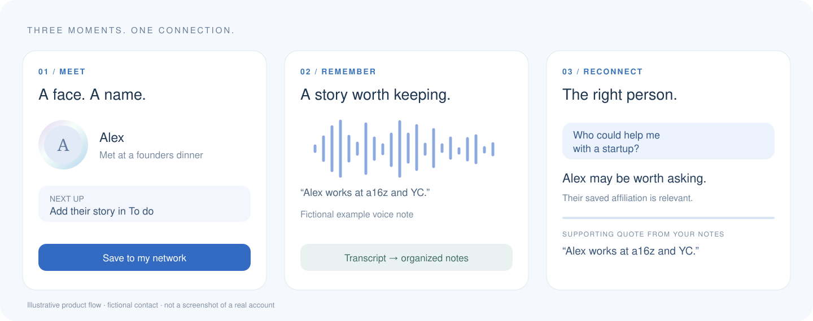

  

<strong>An iPhone-first app for remembering people and finding the right reason to reconnect.</strong>

Working prototype &nbsp;·&nbsp; Voice notes &nbsp;·&nbsp; Conversational recall &nbsp;·&nbsp; Private by design

## A good conversation should go somewhere.

You meet someone interesting. You exchange details. A week later, the useful part of that conversation is hard to remember.

**Network keeps the context.** Save a face and a name, record a quick voice memo, and return to the people around you. Later, ask your network a question in plain language.

  

*Product flow illustration using a fictional contact; not screenshots of a real account.*

## From introduction to useful connection

- **Capture the person.** Name, photo, where you met, and optional contact details. New people land in To do so the conversation does not get lost.
- **Say what matters.** Record or write their story. Audio becomes a transcript, a summary and useful facts. Saving takes you straight back to the remaining To do items.
- **Ask who you already know.** “Who could help with a startup?” returns relevant contact cards and supporting quotes from saved notes.
- **Reconnect naturally.** Open the person's story, replay the original recording, or use Call, Text and WhatsApp.

The home screen brings your network to life as floating, opalescent photo circles with subtle connecting threads. The product is designed around quick capture, minimal navigation and remembering the human detail.

## Built beyond the mockup

The working prototype includes account onboarding, camera capture, recording and playback, AI transcription and note extraction, network search, and local storage with cloud synchronization.

Built with **Expo / React Native, TypeScript, SQLite and Supabase**, with AI processing in authenticated server functions. Records save locally first. User edits take priority over AI extraction. Photos and recordings use private storage, and AI processing requires consent.

Ask verifies contact ownership and checks supporting quotes against saved text. Relevant affiliations can suggest someone worth asking; they do not become invented promises, roles or introductions.

## Engineering checkpoint

At the current prototype checkpoint:

- **55 automated tests passed** across app/domain logic, AI response handling and credential setup.
- **6 live, fictional search regression cases passed**, including startup relevance, misspellings, exact evidence and honest empty results.
- Type checking, lint and an **iOS Hermes bundle export passed**.
- A disposable backend test exercised **voice → transcript → structured notes → Ask**.

These checks support the prototype; they are not a production certification. Physical iPhone acceptance, production email/social-login setup, and broader search evaluation remain. The development provider's request allowance currently blocks the full 120-person search evaluation. Network is not yet an App Store release.

---

**Project showcase.** This repository contains presentation materials only. Application source, backend implementation, credentials and user data are private. All illustrated people and examples are fictional.
